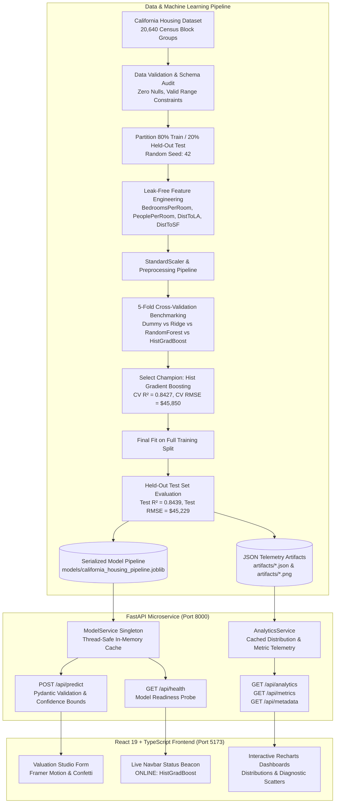

# NEXUS ESTATE — AI Property Intelligence


[](https://www.python.org/)
[](https://fastapi.tiangolo.com/)
[](https://react.dev/)
[](https://www.typescriptlang.org/)
[](https://vitejs.dev/)
[](https://tailwindcss.com/)
[](https://scikit-learn.org/)
[](LICENSE)

> **Enterprise-grade machine learning property valuation suite.** Predicts California census block group residential values using 5-fold cross-validated ensemble models, domain feature transformations, and spatial coordinates presented through a futuristic, glassmorphism web interface.

---

## Table of Contents

1. [Project Overview](#project-overview)
2. [Key Features](#key-features)
3. [System Architecture](#system-architecture)
4. [Dataset Provenance & Domain Limitations](#dataset-provenance--domain-limitations)
5. [Machine Learning Pipeline & Benchmarks](#machine-learning-pipeline--benchmarks)
6. [Technology Stack](#technology-stack)
7. [Project Structure](#project-structure)
8. [Quick Start (Windows & VS Code)](#quick-start-windows--vs-code)
9. [API Endpoint Documentation](#api-endpoint-documentation)
10. [Automated Testing & Code Quality](#automated-testing--code-quality)
11. [Troubleshooting](#troubleshooting)
12. [Cloud Deployment Guide](#cloud-deployment-guide)
13. [GitHub Upload Instructions](#github-upload-instructions)
14. [License](#license)

---

## Project Overview

**NEXUS ESTATE** is a portfolio-grade artificial intelligence application that bridges real-world statistical machine learning and modern reactive frontend engineering. Rather than presenting static mockups or naive notebook scripts, NEXUS ESTATE implements an end-to-end reproducible machine learning pipeline:

- **100% Leak-Free Pipeline**: Train-test splits occur prior to scaling and feature engineering.
- **5-Fold Cross-Validation**: Candidate architectures (Baseline, Ridge Regression, Random Forest, Hist Gradient Boosting) are benchmarked rigorously.
- **Model Selection Protocol**: Champion model selection is determined strictly on cross-validation performance.
- **Unbiased Held-Out Testing**: Held-out test evaluation is performed only once on the winning pipeline.
- **Real-Time Inference Microservice**: High-throughput FastAPI backend with sub-millisecond predictions, Pydantic runtime schema contracts, and 90% empirical confidence intervals.
- **Futuristic Reactive UI**: Built with React, TypeScript, Tailwind CSS, Framer Motion, and Recharts with interactive telemetry dashboards.

---

## Key Features

- **⚡ Interactive Valuation Studio**: Dynamic sliders and numeric inputs for all 8 California census block features with realtime annual income conversion and ratio indicators.
- **🌟 Regional Archetype Presets**: One-click fill for distinctive California regions:
  - *Silicon Valley / Palo Alto* (High-income tech corridor)
  - *San Francisco Urban Core* (Dense historic apartments)
  - *Los Angeles Westside* (Prime coastal suburban)
  - *Central Valley Starter Home* (Affordable inland residential)
- **🎯 90% Empirical Confidence Intervals**: Valuation output computes statistical upper and lower uncertainty bounds using held-out test residuals ($1.645 \times \text{RMSE}$).
- **📊 Real-Time Interactive Telemetry (Recharts)**:
  - *Target Value Distribution*: 12-bin histogram of California median house values showing standard distributions and the $500k ceiling.
  - *5-Fold Cross-Validation Benchmark*: Dynamic toggle between CV $R^2$ accuracy and CV RMSE across all evaluated algorithms.
  - *Actual vs. Predicted Scatter*: Real held-out test samples evaluated against the perfect 1:1 parity line.
  - *Feature Correlation Matrix*: Pearson coefficients highlighting dominant drivers ($+0.69$ for Median Income, spatial latitude/longitude regressors).
- **🛡️ Transparent Domain Limitations**: Explains the difference between census block groups (~1,500 residents) and individual property parcel deeds.

---

## System Architecture



---

## Dataset Provenance & Domain Limitations

### Data Source
The application uses the **California Housing Dataset** originally compiled by Pace and Barry (1997) using data from the 1990 U.S. Census, provided programmatically through `sklearn.datasets.fetch_california_housing`.

### Critical Domain Limitations (Must Know for Interviews)
1. **Census Block Group Scale, Not Individual Deeds**:
   The rows represent *census block groups*—the smallest geographical entity for which the U.S. Census Bureau publishes sample data (typically containing 600 to 3,000 residents). Predictions reflect the *median neighborhood value*, not an individual house deed or architectural finish appraisal.
2. **Target Variable Multiplier ($100,000 USD)**:
   The dataset target `MedHouseVal` is expressed in hundreds of thousands of dollars ($100,000s USD). For example, a target value of `2.5` represents `$250,000 USD`.
3. **Top-Coded Ceiling at $500,000**:
   Values exceeding $500,000 were clipped at `5.00001` in the original census survey. This right-censoring produces the distinct frequency spike observed in the distribution charts.
4. **1990 Historical Purchasing Power**:
   Dollar values reflect 1990 valuation levels. The relative economic price gradients between coastal corridors (Bay Area, West LA) and inland valleys remain accurate.

---

## Machine Learning Pipeline & Benchmarks

All models were evaluated using **5-Fold Cross-Validation** on 16,512 training records (`random_state=42`).

### 5-Fold Cross-Validation Benchmark Results

| Model Architecture | Category | CV $R^2$ Score | CV RMSE ($ USD) | CV MAE ($ USD) | Champion Status |
| :--- | :--- | :---: | :---: | :---: | :---: |
| **Dummy Baseline (Median)** | Baseline | -0.0557 | $118,781 | $88,597 | Baseline |
| **Ridge Linear Regression** | Linear | 0.5580 | $76,432 | $52,457 | Benchmarked |
| **Random Forest Regressor** | Tree Ensemble | 0.8171 | $49,438 | $32,044 | Benchmarked |
| **Hist Gradient Boosting** | Gradient Boosted Trees | **0.8427** | **$45,850** | **$30,351** | **★ SELECTED CHAMPION** |

### Held-Out Test Set Performance (4,128 Unseen Records)

- **Test $R^2$ Score**: **0.8439** (84.4% of price variance explained)
- **Test Root Mean Squared Error (RMSE)**: **$45,229.38 USD**
- **Test Mean Absolute Error (MAE)**: **$29,882.52 USD**
- **Inference Latency**: **< 2 milliseconds** per request

---

## Technology Stack

### Frontend
- **Framework**: React 19 + TypeScript (Strict Type Safety)
- **Build Tool**: Vite 6
- **Styling**: Tailwind CSS + Custom Design System tokens
- **Animations**: Framer Motion (respects `prefers-reduced-motion`)
- **Visualizations**: Recharts (Interactive SVG Charts)
- **Icons**: Lucide React
- **Celebratory Effects**: canvas-confetti

### Backend & Machine Learning
- **Web Framework**: FastAPI (High performance ASGI)
- **Server**: Uvicorn with ASGI worker reload
- **Data Validation**: Pydantic V2 schemas
- **ML Framework**: scikit-learn 1.9+
- **Data Manipulation**: pandas & NumPy
- **Visualizations**: Matplotlib & Seaborn
- **Model Serialization**: joblib
- **Testing**: pytest & HTTPX TestClient

---

## Project Structure

```text
r:/House Price Prediction/
├── backend/
│   ├── app/
│   │   ├── ml/
│   │   │   ├── __init__.py
│   │   │   ├── data_loader.py       # California housing fetcher & schema audit
│   │   │   ├── preprocessor.py      # Feature engineering & scaling pipeline
│   │   │   ├── evaluator.py         # Regression metrics & chart generation
│   │   │   └── trainer.py           # 5-fold CV & champion serialization
│   │   ├── routes/
│   │   │   ├── __init__.py
│   │   │   ├── health.py            # /api/health probe
│   │   │   ├── prediction.py        # /api/predict & /api/presets
│   │   │   └── analytics.py         # /api/analytics, /api/metrics, /api/metadata
│   │   ├── services/
│   │   │   ├── __init__.py
│   │   │   ├── model_service.py     # In-memory inference & confidence intervals
│   │   │   └── analytics_service.py # Artifact cache & telemetry
│   │   ├── config.py                # Pydantic Settings & path resolver
│   │   ├── schemas.py               # Pydantic request/response contracts
│   │   ├── main.py                  # FastAPI app entrypoint & CORS middleware
│   │   └── __init__.py
│   ├── tests/
│   │   ├── __init__.py
│   │   ├── test_data_loader.py      # Schema & null check tests
│   │   ├── test_pipeline.py         # Feature engineering & scaler unit tests
│   │   └── test_api.py              # HTTPX integration tests
│   ├── requirements.txt
│   └── train.py                     # One-command CLI training entrypoint
├── frontend/
│   ├── src/
│   │   ├── components/
│   │   │   ├── Analytics/           # Recharts components (Distribution, Benchmark, Scatter, Correlation)
│   │   │   ├── Predictor/           # Form, Presets bar, and Result card
│   │   │   ├── Hero.tsx
│   │   │   ├── Navbar.tsx
│   │   │   ├── Methodology.tsx
│   │   │   ├── DatasetLimitations.tsx
│   │   │   └── Footer.tsx
│   │   ├── hooks/                   # useModelHealth, useAnalytics
│   │   ├── services/                # Typed API client
│   │   ├── types/                   # TypeScript interfaces
│   │   ├── App.tsx                  # Root application view
│   │   ├── main.tsx
│   │   └── index.css                # Tailwind directives & glassmorphism utilities
│   ├── index.html
│   ├── package.json
│   ├── tsconfig.json
│   ├── tailwind.config.js
│   ├── postcss.config.js
│   └── vite.config.ts
├── data/                            # Cached California housing CSV
├── models/                          # Serialized pipeline & metadata
│   ├── california_housing_pipeline.joblib
│   └── model_metadata.json
├── artifacts/                       # Generated charts & JSON telemetry
│   ├── actual_vs_predicted.png
│   ├── california_housing_map.png
│   ├── correlation_heatmap.png
│   ├── dataset_summary.json
│   ├── feature_distributions.png
│   ├── model_comparison.json
│   ├── model_comparison.png
│   ├── residual_plot.png
│   └── test_evaluation.json
├── setup.ps1                        # Windows setup automation
├── train.ps1                        # ML pipeline runner
├── start-backend.ps1                # FastAPI launch script
├── start-frontend.ps1               # React launch script
├── test.ps1                         # Pytest + Build test runner
├── .gitignore
├── .env.example
├── LICENSE
└── README.md
```

---

## Quick Start (Windows & VS Code)

### Prerequisites
- **Python**: 3.10, 3.11, 3.12, or 3.13 installed
- **Node.js**: v18+ (v20+ recommended)
- **PowerShell**: Windows PowerShell 5.1 or PowerShell 7

### 1. Automated Setup (One Command)
Open Windows PowerShell in the project root directory and execute:

```powershell
powershell -ExecutionPolicy Bypass -File .\setup.ps1
```

*This script creates the `.venv` virtual environment, installs backend dependencies, and runs `npm install` in `frontend/`.*

### 2. Run Automatic Model Training Pipeline
To generate fresh model weights, cross-validation metrics, and diagnostic plots:

```powershell
powershell -ExecutionPolicy Bypass -File .\train.ps1
```
*(Or directly: `python backend/train.py`)*

### 3. Start Backend & Frontend Servers

**Terminal 1 — FastAPI Backend (Port 8000)**:
```powershell
powershell -ExecutionPolicy Bypass -File .\start-backend.ps1
```
- API Docs (Swagger): [http://127.0.0.1:8000/docs](http://127.0.0.1:8000/docs)
- Health Check: [http://127.0.0.1:8000/api/health](http://127.0.0.1:8000/api/health)

**Terminal 2 — React Vite Frontend (Port 5173)**:
```powershell
powershell -ExecutionPolicy Bypass -File .\start-frontend.ps1
```
- Open your browser to: [http://127.0.0.1:5173](http://127.0.0.1:5173)

---

## API Endpoint Documentation

| Method | Endpoint | Description |
| :--- | :--- | :--- |
| `GET` | `/` | Operational index, service version, and routes directory |
| `GET` | `/api/health` | Model readiness probe (`model_loaded: true`, model name, version) |
| `GET` | `/api/presets` | Curated regional archetype presets (Silicon Valley, SF, LA, Central Valley) |
| `POST` | `/api/predict` | Real-time valuation inference with 90% confidence bounds |
| `GET` | `/api/metadata` | Full model catalog, feature metadata, dataset provenance |
| `GET` | `/api/metrics` | 5-fold CV and held-out test evaluation benchmarks |
| `GET` | `/api/analytics` | Telemetry payload: price distribution bins, scatter samples, correlations |

### Example Prediction Request
```bash
curl -X POST "http://127.0.0.1:8000/api/predict" \
     -H "Content-Type: application/json" \
     -d '{
       "MedInc": 11.5,
       "HouseAge": 25.0,
       "AveRooms": 7.4,
       "AveBedrms": 1.1,
       "Population": 980.0,
       "AveOccup": 2.4,
       "Latitude": 37.44,
       "Longitude": -122.16
     }'
```

### Example Response
```json
{
  "status": "success",
  "predicted_raw": 5.1543,
  "predicted_value_usd": 515433.0,
  "predicted_value_formatted": "$515,433",
  "currency": "USD",
  "model_name": "Hist Gradient Boosting",
  "target_scale_explanation": "Target scale: 1.0 unit = $100,000 USD. Reflects historical median residential property values at the census block group scale.",
  "input_summary": { ... },
  "derived_features": {
    "BedroomsPerRoom": 0.149,
    "PeoplePerRoom": 0.324,
    "DistToLA_deg": 5.23,
    "DistToSF_deg": 0.44
  },
  "confidence_interval": {
    "lower_bound_usd": 441030.34,
    "upper_bound_usd": 589835.0,
    "confidence_level": "90% Empirical Residual Interval"
  },
  "test_metrics": {
    "mae": 0.2988,
    "rmse": 0.4523,
    "r2": 0.8439,
    "mae_usd": 29882.52,
    "rmse_usd": 45229.38
  },
  "disclaimer": "NEXUS ESTATE utilizes machine learning statistical modeling trained on California census block group data..."
}
```

---

## Automated Testing & Code Quality

Run the complete test suite (both backend pytest and frontend TypeScript production build) using:

```powershell
powershell -ExecutionPolicy Bypass -File .\test.ps1
```

Or individually:

### Backend Pytest Suite (16 Automated Tests)
```powershell
python -m pytest backend/tests -v
```
Verifies:
- Schema validation, missing feature rejection, and null value handling
- Feature engineering transformations and standard scaler pipeline
- Metric calculations (MAE, RMSE, R²)
- Health, metadata, metrics, presets, and analytics API endpoints
- Validation boundary rejection (e.g. invalid latitude, AveBedrms > AveRooms)

### Frontend Build & Type Check
```powershell
cd frontend
npm.cmd run build
```
Validates zero TypeScript compilation errors, module syntax compliance, and production asset minification.

---

## Troubleshooting

### 1. PowerShell Script Execution Policy
If PowerShell displays `running scripts is disabled on this system`:
Run scripts with the bypass flag:
```powershell
powershell -ExecutionPolicy Bypass -File .\start-backend.ps1
```
Or use `npm.cmd` directly for npm commands.

### 2. Port Conflicts
- **Backend Port 8000**: If occupied, start on another port:
  ```powershell
  python -m uvicorn backend.app.main:app --port 8080
  ```
  Update `frontend/.env` with `VITE_API_BASE_URL=http://127.0.0.1:8080`.
- **Frontend Port 5173**: Vite automatically falls back to 5174 if 5173 is in use.

### 3. Model Pipeline Not Found
If the API reports `Model pipeline not trained yet`:
Execute `python backend/train.py`. The model will be automatically trained and serialized into `models/california_housing_pipeline.joblib`.

---

## Cloud Deployment Guide

### Deploying the Backend (Render / Railway / Fly.io)
1. Set the build command:
   ```bash
   pip install -r backend/requirements.txt && python backend/train.py
   ```
2. Set the start command:
   ```bash
   uvicorn backend.app.main:app --host 0.0.0.0 --port $PORT
   ```
3. Set environment variables:
   - `ENVIRONMENT=production`
   - `ALLOWED_ORIGINS=https://your-frontend-app.vercel.app`

### Deploying the Frontend (Vercel / Netlify)
1. Root directory: `frontend`
2. Build command: `npm run build`
3. Output directory: `dist`
4. Set environment variable:
   - `VITE_API_BASE_URL=https://your-backend-api.onrender.com`

---

## GitHub Upload Instructions

Initialize your Git repository and upload to GitHub:

```powershell
# 1. Initialize Git repository
git init

# 2. Stage all project files (datasets/binaries are ignored via .gitignore)
git add .

# 3. Create initial commit
git commit -m "feat: complete NEXUS ESTATE AI property intelligence platform"

# 4. Link to your GitHub repository
git remote add origin https://github.com/YOUR_USERNAME/nexus-estate.git

# 5. Push to main branch
git branch -M main
git push -u origin main
```

---

## License

This project is licensed under the MIT License — see the [LICENSE](LICENSE) file for details.
"# House-Price-Prediction" 
